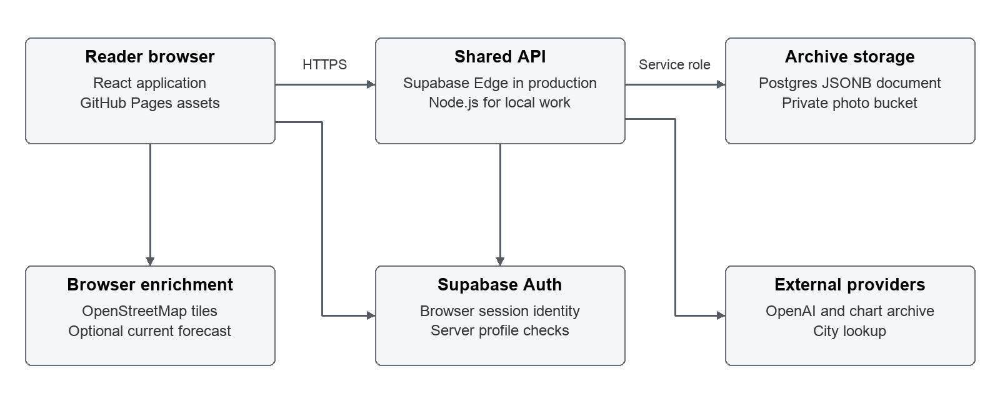
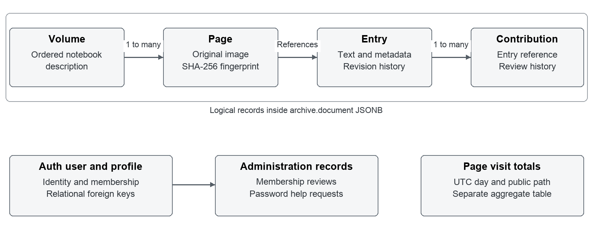
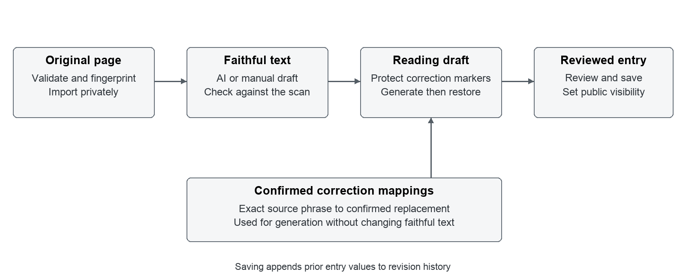

# Seahawk Journal Technical Design

Technical design and operating model for the family fishing archive

Version 0.2 · October 22 2026 · Implementation baseline 1f4aeae

## 1 Purpose and scope

Seahawk preserves Captain Eddie’s fishing log as original photographs, faithful transcriptions, reviewed reading copies, and attributed family contributions. This document describes how the app implements that archive and how maintainers should develop and operate it. It is intended for the app owner, archivists, and engineers taking responsibility for the service.

The current design uses a React application on GitHub Pages and a shared JavaScript API running locally in Node.js or in a Supabase Edge Function. Supabase provides account authentication, Postgres storage, and private photograph storage. The main design constraint is preservation: editorial improvements must remain distinguishable from the original source, and public access must follow entry visibility and contribution review decisions.

### Design priorities

- Preserve original page images and retain prior entry values when edits are saved.
- Keep faithful transcription, reading text, descriptive metadata, and contributed memories separately editable.
- Require server authorization for privileged actions and human review before family submissions become public.
- Make entries discoverable by date, person, and place, with geographic and musical context clearly sourced.
- Keep deployment repeatable and diagnose failures without logging private archive content or credentials.

### Scope and boundaries

The implemented product includes page import, AI and manual transcription, an archivist workbench, a public journal, an Atlas, membership approval, contribution moderation, password help, and aggregate page visits. The latest source also includes a single map with place pins and a weekly Billboard top five section. This document describes those features at the implementation baseline; a successful API release alone does not establish that the matching frontend has been published.

The app does not currently provide a global authority file for people, automatic resolution of questions, a persistent AI learning system, a configured staging release pipeline, or service alerts. Those improvements are proposals, not existing guarantees.

### Document map

Sections 2 through 5 cover architecture, data, workflows, and AI behavior. Sections 6 and 7 define archival image capture and upload handling. Sections 8 through 10 cover reader features, APIs, and security. Section 11 inventories caching. Sections 12 through 14 cover environments, CI and CD, and observability. Sections 15 through 17 cover reliability and testing, design decisions, and implementation references.

The terms **Implemented** and **Proposed** distinguish existing source behavior from recommendations that require a separate implementation decision. Runtime versions and service settings below describe repository configuration, not general vendor requirements.

<!-- page -->

## 2 System architecture

**Implemented.** The browser loads a static React 19 and TypeScript application built by Vite. GitHub Pages serves production assets under `/seahawk/`. Production uses hash routes so a direct link such as `/seahawk/#/entries/E001` works without an application server rewriting paths.

The browser calls the `ships-log` Edge Function for archive operations. `lib/edge-handler.js` adapts Fetch requests to the same handler exported by `server.js`; it supplies CORS headers and transforms authorized photograph paths into signed Storage URLs. The handler verifies account identity and loads permissions from the database before allowing protected operations. Supabase Auth endpoints are also called directly by the production browser SDK for signup, sign-in, sign-out, and ordinary password changes.

Postgres stores the archive document and account administration records. The private `archive-photos` bucket stores page and contribution photographs. The Edge runtime receives privileged credentials; the browser receives only public configuration and its own session tokens. Row level security and revoked browser grants prevent direct archive access through the Supabase browser client.

### Request and dependency boundaries

Archive reads normally load configuration before fetching the public or workspace archive. The frontend then filters entries locally. The radio endpoint is handled before loading the archive document because it depends only on a validated date and public chart data. It still passes through the shared account-access setup.

OpenAI is a server dependency for transcription and reading generation. City lookup and chart retrieval also run on the server. Map tiles and optional present-day forecasts load directly in the browser. Those services have different failure paths: an unavailable chart or forecast should not prevent reading a saved entry.

### Local execution

Local Node serves the compiled frontend and API on loopback port 8000. During frontend development Vite on port 5173 proxies API and photograph requests to Node. Local authentication uses HttpOnly cookies; production uses browser SDK bearer sessions because Pages and the API have different origins. Tests can substitute isolated filesystem stores and fake services, but ordinary production startup requires Supabase configuration.

<!-- page -->

## 3 Data model and provenance

**Implemented.** The archive lives in a singleton Postgres row, `archive.id = 1`, containing a JSONB `document` and numeric `version`. The JSON preserves the existing archive schema and includes volumes, pages, entries, contributions, and reserved trip and artifact collections. Accounts and operational records use separate relational tables.

A page records its image path, SHA-256 fingerprint, volume, order, label, and creation time. An entry references one or more pages and records title, dates, text, people, places, uncertainties, weather, visibility, review status, provenance, and revisions. A page can contain multiple entries. Sharing any one of them makes that complete original page available to readers of the shared entry.

People are strings inside each entry. Places are embedded objects containing the name as written, optional canonical name, roles, coordinates, precision, and source information. Neither is currently a globally identified entity. Atlas grouping uses a normalized display name and exact coordinates; differently named or differently located records can remain separate pins.

### Independent editorial fields

| Field group | Meaning | How it changes |
| --- | --- | --- |
| Transcription | Faithful rendering of the manuscript | Explicit entry edit |
| Reading version | Edited copy for easier reading | Generation or explicit edit |
| Confirmed corrections | Exact source phrase and replacement | Explicit entry edit |
| People and places | Names and descriptive metadata | Explicit entry edit |
| Uncertainties | Questions shown under Details to clarify | Explicit entry edit |
| Revisions | Previous editable values and save time | Appended when an entry is saved |

An approved identification can be linked to an entry revision through its contribution ID. Entry provenance records the import method and model where applicable. Revision history is application history, not a complete tamper-proof audit: entry revisions do not currently include a dedicated editing-actor field.

The `profiles` table references Supabase Auth users and stores display names, roles, and approval status. `membership_reviews` and `password_help_requests` preserve administration history. `page_view_daily` contains aggregate counts keyed by UTC day and canonical public page path. Database foreign keys enforce account relationships; references within the JSON document are maintained by application validation.

<!-- page -->

## 4 Users and archive workflows

**Implemented.** Account identity, membership approval, entry visibility, and contribution approval are separate decisions. A person may read public entries without an account, but submitting material requires an approved crew account or archivist access.

| Capability | Public or pending | Approved crew | Archivist |
| --- | --- | --- | --- |
| Read publicly shared material | Yes | Yes | Yes |
| Submit memories and clarifications | No | Yes | Yes |
| View own submission history | No | Yes | Yes |
| Read private entries | No | No | Yes |
| Import and edit entries | No | No | Yes |
| Review submissions and membership | No | No | Yes |

### Import and editorial review

The archivist uploads a JPEG, PNG, or WebP photograph of up to 12 MB. The server validates the payload and signature and rejects a duplicate page fingerprint. Manual import creates a transcription placeholder. Automatic import sends the image to OpenAI, which may split the page into dated passages and an undated introduction. New imported entries are private drafts; AI-generated coordinates are cleared.

The workbench places the original image beside editable text. The archivist checks the transcription, records confirmed replacements, generates or edits the reading version, and updates descriptive fields. Generation changes the browser draft. Saving persists the entry and retains its previous values. The editor warns before replacing an existing reading version and before navigation that would discard unsaved changes.

### Sharing and contributions

Visibility is `private`, `help`, or `shared`. Both `help` and `shared` are publicly readable; they are not separate access-control groups. Entries lacking an explicit visibility value use `help` for compatibility. Public responses omit private entries, editorial notes, revision history, and private review details.

Crew submissions can be memories, identifications, clarifications, or photographs. They start pending and become public only after archivist approval. A clarification is tied to a string that is currently present in the entry’s uncertainties. Approval records a moderation decision; it does not rewrite transcription or resolve the related uncertainty. Applying an approved identification opens proposed People and editorial-note edits for review and explicit saving.

### Account administration

Signup creates a pending profile. Email serves as a login identifier without confirmation mail; the archivist verifies the person offline before approval. Password help creates a private pending request, not a reset email. The archivist verifies identity, reauthenticates, changes the password, revokes refresh sessions, and records completion. Already issued access tokens can remain usable until expiry.

<!-- page -->

## 5 AI generation and correction handling

**Implemented.** OpenAI requests use the Responses API with a configured model; the repository default is `gpt-4.1`. Requests set `store: false` and have a 180 second timeout. The application validates the returned structure before accepting generated entries or reading text. Manual transcription remains possible without an API key.

The transcription prompt asks for original spelling, punctuation, and line breaks, with `[illegible]` and tentative `[word?]` readings. It prohibits invented coordinates, routes, or weather. Those are instructions to the model, not proof of semantic accuracy; human comparison against the page remains necessary. The server validates entry structure and clears all AI-imported coordinates.

### Confirmed replacements

A correction maps an exact, case-sensitive `as_written` phrase to a `corrected` value. The server accepts up to 100 mappings, each with nonblank source and replacement strings of at most 1,000 characters. During generation every source phrase must appear in the transcription. Replacements operate once against the original input, so one replacement cannot trigger another.

Before calling the model, matched phrases become opaque `ARCHIVE_CONFIRMED_` markers. Longer source phrases take priority where alternatives begin at the same position. A mapping completely shadowed by another match is rejected. After generation, the server checks each confirmed marker’s occurrence count and restores the exact replacement text. Missing or altered markers fail the operation. Unresolved bracketed markers must still appear, although their occurrence counts are not checked in the same way.

### Review and limitations

The resulting reading version starts as `ai_draft`. The editor allows the archivist to mark it reviewed. Changes to transcription, reading text, or mappings reset an existing reading review flag in the editor. The API currently validates supplied review-state values but does not independently enforce all of these user-interface transitions.

Corrections affect reading generation only. They do not modify the faithful transcription, People, Places, or Uncertainties; they do not train a model or transfer to another entry. A mapping can be saved after its source phrase has disappeared, because source-presence validation happens during generation rather than ordinary entry saving.

**Proposed.** Link confirmed answers and corrections to structured uncertainty records. Resolving a question should retain the question, answer, source, actor, and time while removing it from the unresolved display. Preserve explicit review before any replacement changes archived text.

<!-- page -->

## 6 Archival quality image capture

**Recommended capture workflow.** Preserve an untouched camera original and create a separate access image for the app. Archival quality depends on focus, lighting, complete page coverage, color handling, provenance, and verified storage; camera resolution alone does not establish compliance with a digitization standard. The reference device here is the standard Ricoh GR III, not the GR IIIx or an HDF variant.

### Ricoh GR III reference specifications

| Property | Published GR III specification |
| --- | --- |
| Sensor | 23.5 x 15.6 mm CMOS with approximately 24.24 effective megapixels |
| Lens | Fixed 18.3 mm lens with a 28 mm full-frame equivalent view and f/2.8 to f/16 aperture |
| Full image | 6000 x 4000 pixels at the large 3 to 2 setting |
| File formats | 14-bit RAW in DNG format and JPEG with Exif metadata |
| Color spaces | sRGB or Adobe RGB |
| Capture options | RAW plus JPEG, manual exposure, custom white balance, and a two-second self-timer |

Source: Ricoh GR III specifications and recording-format FAQ, accessed October 22, 2026. https://www.ricoh-imaging.co.jp/english/products/gr-3/spec/ and https://www.ricoh-imaging.co.jp/english/support/qa/gr-3/index.html

### Capture procedure

1. Support the notebook without forcing its binding flat. Photograph one complete page per frame, including edges and page identifiers. Keep a scale and a neutral or color target beside a representative page where practical.
2. Mount the camera securely and keep its sensor plane parallel to the page. Use even, diffuse lighting from both sides and check for glare, gutter shadows, and distortion. These are recommended reproduction practices, not Ricoh guarantees.
3. Use RAW plus full-size JPEG with crop mode off. Start at ISO 100 and around f/5.6, then verify sharpness across the actual page. Set a consistent white balance and avoid creative image effects, heavy noise reduction, or processing that removes faint strokes.
4. Inspect the center, corners, gutter, and lightest handwriting at full pixel view before continuing the batch. Keep a capture log linking notebook, page order, filename, operator, and capture date. Camera capture time must not become the journal entry date.

### Resolution and preservation decisions

Use measured pixels across the physical page, not a changed DPI metadata tag, to assess sampling. As a geometric example, fitting an 8.5 by 11 inch page inside a portrait 4000 by 6000 frame gives at most about 470 pixels per inch before allowing for margins, cropping, and alignment. Actual sampling will be lower and must be measured. Fine handwriting may require a closer capture or additional detail photograph.

Retain the original DNG with its metadata and an independent checksum manifest. Keep a second verified copy separately. A color-managed 16-bit TIFF can be a preservation derivative when the project requires it; the GR III does not directly capture TIFF. Preserve editing history and never overwrite the original to make an upload smaller. Use an sRGB JPEG access copy for ordinary browser viewing. Formal preservation targets and acceptance criteria remain an owner decision, not an implemented app certification.

<!-- page -->

## 7 Archival image upload and processing

### What the app supports today

**Implemented.** The archivist selects one JPEG, PNG, or WebP file at a time. Both the import dialog and API enforce a 12 MiB file limit, meaning 12,582,912 bytes, although the interface labels it 12 MB. The Storage bucket applies the same limit. The API accepts base64 image data inside JSON and caps the whole request at 18 MiB. Encoding increases transfer size by roughly one third, so raising just the frontend limit would not enable large-file ingestion.

The server checks base64 encoding, file signatures, and a SHA-256 fingerprint. It retains the uploaded bytes in private Storage and records the image reference and hash on the page. It does not resize, recompress, decode pixel dimensions, normalize orientation, extract camera metadata into structured fields, generate thumbnails, or certify capture quality. Duplicate detection identifies identical bytes, not another export or photograph of the same page.

A full-size GR III JPEG is accepted if its actual file size fits the limit. Size varies by image and compression. DNG and TIFF are rejected regardless of size. To use the app today, retain the DNG in a separate preservation collection and upload a carefully prepared sRGB JPEG within the limit. The app cannot yet associate that JPEG with its external master through a dedicated master record.

Automatic transcription sends the uploaded access image to OpenAI using high image detail. It does not develop RAW files or offer an archival resolution guarantee. In the current automatic path, transcription succeeds before the page import commits; if generation fails, the original is not saved by that request. Manual import can preserve the access image first, but a background transcription queue is not currently implemented.

### Proposed master and derivative pipeline

**Proposed.** Add an authenticated upload session for an immutable master and a separately derived access image. Transfer large masters directly to a dedicated private bucket with a short-lived, narrowly scoped upload authorization and resumable uploads. Set limits from measured GR III samples and operating costs; coordinate bucket, gateway, upload-session, and worker limits rather than selecting a larger JSON limit alone.

After upload, verify object size and checksum, safely decode the file, check pixel and resource limits, and record format, dimensions, color profile, original filename, camera, capture time, and processing history. Model these as distinct master, preservation-derivative, access, thumbnail, and transcription-input assets with parent references and immutable identifiers. Restrict RAW and TIFF masters to archivists by default; public responses should sign only approved viewing derivatives.

Run derivative creation and transcription as retryable jobs with visible pending, processing, failed, and ready states. Persist a verified master independently of transcription success. Normalize orientation and color in access copies, record transformation versions, and preserve source metadata privately while excluding unnecessary GPS and identifying metadata from public copies. Use object existence checks and a manifest for reconciliation and cleanup.

Acceptance should verify unchanged master checksums, full-resolution legibility, retrievable backups, correct master-to-page links, resumed uploads without duplication, and derivative regeneration without overwriting originals. The master is durable evidence, never an expendable cache. This pipeline requires new storage policy, data fields, upload endpoints, workers, and tests; it is not implemented by this document update.

<!-- page -->

## 8 Journal Atlas and historical context

### Journal and search

**Implemented.** The journal displays shared entries as cards and opens stable entry pages. Search is a case-insensitive substring match against serialized titles, both text versions, people, places, dates, and eligible contribution fields. Public search includes approved contributions; workspace search can include submissions still under review. Search does not query a dedicated database index and does not currently search the uncertainties list or editorial notes.

The `q` URL parameter holds the search value. Selecting a person or place in entry facts opens the public journal with that name prefilled. A place uses its canonical name when available. Search is broad text matching, so a result may mention the name in narrative text rather than the corresponding People or Places field. Workspace filters additionally support task and transcription quality.

### Atlas

The Atlas renders one OpenStreetMap tile map with pins for places having finite latitude and longitude values. The map fits the visible selection, supports dragging and keyboard panning, and offers zoom and Show all places controls. Longitude fitting handles locations across the date line.

Repeated mentions with the same normalized display name and exact coordinates share a pin. Selecting a pin opens an accessible dialog with the place name, entry count, coordinates, associated entries, precision, sources, and a journal link prefilled with the place name. Unmapped records remain listed below the map. No route is drawn from place order, and coincident pins for different names are not currently clustered or separated.

### Weather and songs

Recorded weather remains part of the archive. A place dialog can separately load a three-day present-day forecast from Open-Meteo in Fahrenheit and knots. The display identifies its timezone, retrieval time, and source, and does not save it as evidence of historical weather.

The radio section loads the Billboard Hot 100 top five through `/api/radio?date=YYYY-MM-DD`. It displays a numbered list as Song - Artist, the chart date, and source links. The server uses the public `mhollingshead/billboard-hot-100` data archive; it does not scrape Billboard directly. These songs provide period context, not evidence of what the crew actually played.

The lookup chooses the earliest listed chart date on or after the entry date and less than seven days later. Using the provider’s date index handles historical weekday changes. Dates before August 4, 1958, missing weeks, and future dates yield an explicit empty state. Missing or invalid entry dates do not trigger a browser lookup. Date certainty remains stored in the entry, but the radio section intentionally omits the inferred-date note. Radio data is omitted from the current print view.

The chart-date index is cached for 24 hours per server instance. Up to 128 weekly chart promises are retained with oldest-insertion eviction; failed fetches are removed for retry. Chart requests have a 10 second timeout per fetch. There is no shared durable chart cache or pinned data snapshot, so provider corrections can change results after cache turnover.

<!-- page -->

## 9 API contract and external integrations

**Implemented.** The API uses JSON over HTTP. Write operations use POST and require an object body with `Content-Type: application/json`. The server caps request bodies at 18 MB, accommodating base64 encoding of an allowed photograph. The Edge adapter preserves shared handler behavior and returns errors as `{ error: message }`.

| Route family | Access | Purpose |
| --- | --- | --- |
| GET /api/config | Public | Role and available app capabilities |
| GET /api/family | Public | Shared entries and approved contributions |
| GET /api/radio | Public | Top five songs for a validated date |
| GET /api/archive | Archivist | Complete archive document |
| GET /api/preview/:id | Archivist | Family presentation of one private entry |
| GET /api/me | Approved crew | Own contribution history |
| GET /api/members and /api/password-help | Archivist | Account administration queues |
| GET /api/analytics | Archivist | Last 30 UTC days of page visits |
| POST /api/contributions | Approved crew | Submit attributed family material |
| POST /api/contributions/:id/review | Archivist | Moderate a submission |
| POST /api/import and /api/entries/:id | Archivist | Import a page or save an entry revision |
| POST /api/reading-version and /api/places/lookup | Archivist | Generate reading text or locate a city |
| POST /api/members/review and /api/members/reset-password | Archivist | Membership decision or verified reset |
| POST /api/page-view | Public | Increment a validated public-page counter |
| POST account action routes | Depends on action | Local Auth flows and password help |

Production browser signup, sign-in, sign-out, and ordinary password changes use the Supabase SDK directly. The account action routes also support the local server; they should not be confused with the legacy invitation and shared-password helpers retained only for compatibility tests.

### Errors and dependency failures

Validation normally returns 400; authentication and authorization failures return 401 or 403. Missing resources return 404, stale saves return 409, and oversized payloads return 413. Chart and place provider failures can return 502; backend configuration or persistence failures can return 503. Unexpected exceptions return a generic 500 without private details.

OpenAI, city lookup, forecasts, and chart retrieval each have bounded request timeouts. External responses are checked before use, and React escapes displayed text. Requests are not automatically replayed after a failed save because a later archive version may require a new editorial decision. **Proposed:** publish a machine-readable API schema and explicit compatibility version before independent clients depend on the API.

<!-- page -->

## 10 Security and privacy

**Implemented.** The API is the authorization boundary. The Edge gateway permits public requests with `verify_jwt = false`, so each protected route must verify the caller through Supabase Auth and check the server-read profile. Roles and approval status never come from browser claims or signup metadata. The service credential can bypass database policies and must remain server-only.

Archive, account administration, and aggregate traffic tables enable row level security and deny direct access to browser roles. Service-only RPCs perform archive version updates, membership reviews, password-help transitions, and page counting. The private photo bucket has no public object URLs. Authorized responses sign referenced photographs for one hour. Signed links remain usable until expiry and are not revoked immediately when entry visibility changes.

### Browser and origin controls

The production browser SDK persists its session and sends bearer tokens to the Edge API. Local Node uses HttpOnly cookies with SameSite=Lax and Secure when the configured origin is HTTPS. The Edge adapter discards cookies and accepts CORS requests only from the configured origin. CORS is a browser control; server permission checks remain necessary for non-browser callers.

POST routes check the request origin. Local cookie mode also rejects cross-site browser writes. The HTML content security policy limits scripts to the application origin, restricts frame and network destinations, and forbids plugins. React renders user content as text. These controls reduce exposure but do not establish a general guarantee against cross-site scripting; browser token storage makes future script changes security-sensitive.

### Content and account boundaries

Public filtering removes private entries and pages used exclusively by them. Editorial notes and revision arrays are removed from public entries, and pending contributions and review notes are excluded. Shared-page exposure is deliberate: making an entry public can reveal neighboring handwriting belonging to another entry on the same photograph.

No confirmation email or emailed recovery link is used. Passwords must be 12 to 128 characters at the application boundary. Local throttling complements Supabase limits but is process-local, and direct browser Auth calls depend on provider-side protections. Offline identity verification is part of membership and password-help operations.

`.env`, archive records, photographs, dependency state, and build output are excluded from Git. The configured pre-commit hook and CI audit inspect indexed content for private paths and credential patterns. This supplements review; it cannot prove that arbitrary personal information is absent.

**Proposed.** Define credential rotation and access-review ownership, periodically verify hosted Auth settings, and review provider diagnostic output before sharing it. Supabase platform logs have their own content and retention policies; the app’s structured-log exclusions do not govern every provider log.

<!-- page -->

## 11 Caching and retained state

**Implemented inventory.** Cache disabled in diagnostics means archive HTTP caching is disabled; it does not describe every retained value. Application code has no service worker, offline archive, IndexedDB archive, distributed cache, or persistent enrichment store.

| Layer | Scope and lifetime | Freshness and invalidation |
| --- | --- | --- |
| Chart date index | One promise per running API instance with a 24-hour expiry | Reloaded on demand after expiry; concurrent requests share it; failures clear it |
| Weekly chart results | Up to 128 promises keyed by chart date in each instance | No time-based expiry; oldest inserted is evicted at capacity; failures clear the key; restart clears all |
| Signed photo URL reuse | One map for one response transformation | Repeated object paths share a signing result; discarded afterward; resulting links expire in one hour |
| Archive and configuration in React | Current application instance in one browser tab | Reloaded when workspace mode, preview ID, or refresh version changes; ordinary navigation reuses them |
| Filtered journal entries | React useMemo result | Recomputed when archive, query, quality, workspace, or task changes; not a separate network cache |
| Enrichment and editor state | Mounted radio, forecast, lookup, and editor components | Radio reloads on date or retry; forecasts refresh explicitly and clear on unmount; drafts are unsaved state |
| HTTP and hosting | Node and Edge handler responses set no-store | Pages assets, signed Storage downloads, and map tiles follow their providers and browser headers |
| CI dependency cache | GitHub setup-node pnpm cache with lockfile-based keys | Reuses package-manager downloads; frozen installs still run; it does not cache archive data |

### Authentication diagnostics and temporary memory

Production browser Auth sessions persist through the Supabase SDK with automatic refresh; they retain credentials rather than archive responses. Sign-out and expiry govern access. Server service and bearer clients disable session persistence. A legacy test-only helper keeps workspace sessions in memory for 12 hours.

Diagnostics retain 30 request records and counters until reload. A ref suppresses repeated recording of the current public path until navigation changes. Auth attempt counters use process-local 15-minute windows with lazy cleanup. Database snapshots, pending photo buffers, and collection-building maps are temporary working state, not shared read caches.

### Operational consequences

React can retain a stale archive after another user edits; refresh retrieves updates and new photo links. Version checks still reject conflicting writes. Photo links are not refreshed on an automatic timer. Clearing browser state or publishing frontend assets does not clear Edge chart caches. Provider chart corrections remain unseen until eviction or instance turnover because weekly results have no TTL.

The app sets no explicit Storage cache lifetime or purge procedure. Vite content hashes distinguish builds; Pages and map-provider CDN lifetimes are provider-controlled. Inspect response headers for stale assets. Proposed image derivatives should use immutable source-hash and transformation-version keys; preservation masters remain durable evidence.

**Proposed.** Add cache metrics and last-fetch time, clarify diagnostics, and define refresh after permission changes. Any shared archive cache must separate public and privileged responses and recheck authorization.

<!-- page -->

## 12 Environments and configuration

**Implemented.** The repository supports local execution, isolated tests, and production. It does not define a separate staging project or preview deployment pipeline. Local development can point at local Supabase or a hosted project, so environment identity must be checked before migrations or imports.

| Environment | Frontend and API | Data and identity | Release behavior |
| --- | --- | --- | --- |
| Local development | Vite 5173 plus Node 8000, or compiled app on Node | Local or explicitly configured hosted Supabase | Manual commands and process restart or watch mode |
| Automated tests | Node handler and Edge adapter tests | Temporary fixtures and mocked services | CI builds and tests without production credentials |
| Production | GitHub Pages plus Supabase Edge | Hosted Auth, Postgres, private Storage | GitHub Actions release workflow |
| Staging proposed | Separate preview frontend and Edge API | Separate project and synthetic or sanitized data | Required verification before production promotion |

### Configuration ownership

Local server configuration uses `SUPABASE_URL`, `SUPABASE_PUBLISHABLE_KEY`, `SUPABASE_SECRET_KEY`, `APP_ORIGIN`, and optional `PORT`. `OPENAI_API_KEY` enables generation; `OPENAI_MODEL` selects the configured model. Ordinary Node startup requires Supabase rather than falling back to filesystem archive storage.

Production frontend variables are `VITE_PAGES`, `VITE_BASE_PATH`, `VITE_SUPABASE_URL`, `VITE_SUPABASE_PUBLISHABLE_KEY`, and `VITE_EDGE_API_URL`. They are embedded at build time and are public. Secret credentials must never receive a `VITE_` prefix. `VITE_PAGES=true` enables hash routing, and the release derives the base path from the repository name.

GitHub stores `SUPABASE_ACCESS_TOKEN` as a deployment secret and the project reference and frontend values as configuration variables. The `production` environment gates backend deployment, while `github-pages` gates frontend publication. Supabase Edge provides server credentials to the runtime; application secrets include the exact allowed Pages origin and optional OpenAI settings.

Changing a Vite variable requires a frontend rebuild. Changing Node code requires restarting the process unless watch mode is enabled. Edge changes require a function deployment. This distinction explains how a new radio component can call an older backend and receive 404 even though the frontend compiled successfully.

### Environment separation proposal

Use separate Supabase projects and frontend origins for staging and production. Give each its own credentials, Auth redirect allowlist, storage, migration state, and deployment environment. Keep only synthetic or approved sanitized records outside production. Validate required configuration before release and display a maintainer-visible build and API revision so mismatches are diagnosable. Define who may promote a release and how a production backup is verified before a migration; these policies are not yet enforced by repository automation.

<!-- page -->

## 13 CI CD and release management

**Implemented.** The Check workflow runs for pull requests and pushes to `main`. It checks out source, installs pnpm 11.25.0 and Node 24, installs dependencies using the frozen lockfile, scans indexed files for secrets, and runs `pnpm test`. That script performs TypeScript checks, a Vite production build, and Node tests. The release baseline passed 72 tests; that count should change as coverage grows.

The Deploy workflow runs after a push to `main` or a manual dispatch. It uses a production concurrency group with `cancel-in-progress: false`. The active deployment is not automatically cancelled by a newer run. Environment approval and branch rules are configured in GitHub and can delay jobs independently of code execution.

### Deployment sequence

1. **Verify source.** Repeat the frozen dependency install, secret audit, type check, build, and tests without deployment credentials.
2. **Deploy the backend.** Enter the `production` environment, link the configured Supabase project, apply forward migrations, and deploy the `ships-log` function.
3. **Smoke test the API.** Require public configuration and family reads to succeed, verify tracing headers and signed photo links, confirm private archive access is denied anonymously, and check allowed and disallowed CORS behavior. Retrieve platform diagnostics if this job fails.
4. **Build the production frontend.** Inject public Vite configuration, derive the Pages base path, compile the application, and upload the static artifact.
5. **Publish Pages.** Enter the `github-pages` environment and deploy the uploaded artifact using the Pages and identity-token permissions granted to that job.
6. **Verify the release operationally.** Confirm both backend and frontend publication, then check the journal, a dated entry’s songs, Atlas pins, and protected workflows. These browser checks are currently an operator responsibility.

### Compatibility and rollback

Backend and frontend are separate releases. The old frontend can remain live after a successful backend deployment if Pages publication waits or fails. Additive APIs and forward-compatible migrations therefore matter. Feature-specific checks should be added when releasing a new dependency; the current generic API smoke script does not test radio retrieval or the Atlas interaction.

Applied migrations should remain immutable. A frontend rollback republishes a known-good artifact or compatible source revision. Database repairs require a separately reviewed forward migration. Re-running an older commit’s entire release workflow can also deploy its older API, so a frontend-only rollback procedure should explicitly control which stages execute.

**Proposed.** Require a protected review path, add staging and browser smoke tests, record release SHAs in the UI and API, and establish a bounded response time for waiting deployments. Retain release artifacts and associate each with migration versions. The repository does not currently guarantee required reviewers, approval service levels, automated rollback, or a fixed recovery time.

<!-- page -->

## 14 Observability and service operations

**Implemented.** The API assigns a UUID request ID and returns `X-Request-ID` and `Server-Timing`. A structured `api_request` event records a route category, method category, status, fixed cache label, and elapsed phase durations. The Edge adapter exposes tracing headers to the browser through CORS.

### Current signals and their limits

| Signal | Current behavior | Practical limit |
| --- | --- | --- |
| Request tracing | Request ID links browser calls to function logs | Gateway or CORS rejections before the shared handler lack this trace |
| Server timing | Auth, database, commit, photo signing, optional analytics, and total | Only executed phases appear; no dedicated external-provider phase |
| Browser diagnostics | Request count and latest 30 API records in tab memory | SDK Auth, tile images, and direct forecast calls are outside this wrapper |
| Journal timing | First recorded frame after public archive content commits | Approximation; excludes complete photo loading and is not a repeated-visit benchmark |
| Page visits | Atomic daily public-page counters in UTC | Repeat visits count; requests can be blocked or spoofed |
| Deployment diagnostics | CI output, API smoke script, and platform log retrieval | No application alert routing or automatic incident ownership |

The server log deliberately excludes query strings, payloads, identities, token values, signed photo URLs, and exception text. Unknown route groups, including radio, collapse to `/api/other`. Total server duration starts in the shared handler; it excludes gateway time and platform startup before the handler, and is captured before response transfer completes.

The diagnostics panel reports archive caching as disabled, and structured requests always emit `cache: disabled`. That label does not describe the radio service’s internal cache. There are no chart cache hit, miss, eviction, or provider latency metrics yet. Supabase Auth requests made directly by the browser also need separate provider investigation.

### Traffic and retention

The workspace shows the most recent 30 UTC days from `page_view_daily`. It records the journal, Atlas, and public entry paths, excluding search strings, workspace pages, and private previews. No application visitor ID or raw page-view event is stored. Thirty days is the query window, not a deletion policy; the schema does not implement aggregate pruning. Browser diagnostics reset with the page. Function log retention follows provider configuration rather than an application retention schedule.

### Diagnosis and proposed operations

For a reported failure, identify the affected route and build, reproduce the request, record its ID and status, and compare browser duration with server phases. Check deployment state and configuration before changing archive data. A radio 404 can indicate a frontend/API revision mismatch; 502 suggests chart-provider retrieval or validation failure. Use the manual Diagnose API workflow when platform initialization fails before normal tracing is available.

**Proposed.** Assign the app maintainer as the initial incident contact, subject to owner confirmation. Establish baselines before setting availability and latency targets. Add read-only synthetic journal checks, sustained 5xx and latency alerts, provider-failure counters, and deployment-wait alerts. Define alert recipients, retention, escalation, and response expectations before calling these operational guarantees.

<!-- page -->

## 15 Reliability performance and verification

### Persistence and recovery

**Implemented.** Every request owns an archive snapshot. Entry edits compare the caller’s revision number with the current revision count. The database then atomically replaces the archive only if its version still matches the loaded version. A stale entry edit or cross-request archive change returns 409 rather than silently overwriting another save. The client must reload and reconcile; the server does not merge edits automatically.

Photographs are uploaded privately before the JSON document is committed. A confirmed version conflict can remove newly uploaded objects. An ambiguous network failure leaves objects intact because the commit may already have succeeded. This avoids deleting referenced evidence but can leave unreferenced private objects requiring maintenance. Database persistence and object storage do not form a single transaction.

Backups must cover the database, Auth administration state as appropriate, and Storage objects. JSON export alone is insufficient for photograph recovery. The repository documents backup needs but does not implement an automated backup schedule or restore drill. **Proposed:** define recovery point and recovery time objectives with the owner, schedule independent object backups, and test restoration into an isolated project before relying on the procedure.

### Performance and scale

Most archive reads retrieve the complete JSON document, then construct the authorized response. The browser loads the permitted archive and performs search locally; public photo references are signed during response transformation. Archive size, revision growth, photograph count, and concurrent writes can therefore increase payloads, signing latency, and global version conflicts.

The chart lookup has bounded in-memory caching, but archive responses remain `no-store`. There is no shared API cache, pagination contract, or search service. Measure request phases and payload size before adding cache layers. Likely scale improvements are per-entry persistence, paginated public projections, explicit person and place IDs, indexed search, and independent revision storage. Preserve existing IDs and links through any migration.

### Verification strategy

The current suite covers archive editing, stale writes, duplicate imports, contribution moderation, access boundaries, Edge adaptation, date and coordinate parsing, AI output protection, radio week selection, failures, caching, analytics, and observability. Tests use temporary files, synthetic records, and mocked Supabase responses; they do not establish live migration correctness, hosted Auth settings, provider availability, or full browser usability.

CI combines type checking, build verification, and Node tests. The API deployment smoke test adds a live check of public reads, tracing, signed URLs, access denial, and CORS. **Proposed:** add browser checks for keyboard and mobile navigation, map dialogs, name-to-search links, radio loading and retry states, member approval, and stale-edit recovery. Add migration tests against a disposable database and a release check that the published frontend SHA matches the intended API release.

Acceptance should require source photographs to remain accessible to authorized readers, private material to remain excluded from anonymous responses, and failed enrichment calls to leave saved archive data unchanged.

<!-- page -->

## 16 Open decisions and planned improvements

The following items require product or operating decisions. Their inclusion does not imply they are already implemented or approved work.

### Resolve questions with recorded answers

Replace free-text-only uncertainties with stable question IDs and resolution records. Record the answer, evidence, contributor, reviewing archivist, and resolution time. Offer an explicit Resolve question action that removes the item from the unresolved display while preserving its history. Decide whether resolving a question should propose a reading correction, metadata change, or both; require review before saving those changes.

### Reuse confirmed identities

Introduce stable IDs for people and places before propagating identifications across the archive. Preserve names as written and aliases alongside canonical display names. Decide how conflicting family recollections are represented and whether a suggested merge requires separate approval. Avoid treating identical names as proof of the same person or location.

### Strengthen review and public projections

Enforce review-status transitions at the API boundary, not only in the editor. Validate source phrases when saved correction mappings become stale. Define a public entry schema rather than spreading the stored object and deleting selected private fields; this makes future field exposure deliberate. Decide whether a contributor’s ownership link survives account deletion and how account removal affects retained attribution.

### Improve geographic and historical context

Add a deliberate interaction for overlapping map pins. Decide whether approximately equal coordinates should group and how precision affects that decision. Review chart data availability, provider terms, and long-term archival needs before creating a durable local copy. If reproducibility is required, record provider version, retrieval time, and selected chart date alongside a retained enrichment snapshot.

### Establish deployment and operational ownership

Choose the staging environment, release reviewer policy, backup owner, incident contact, log retention, and service targets. Add independent backend and frontend release identifiers and a publication check so a waiting Pages job cannot be mistaken for a completed release. Define the frontend-only rollback path and verify it with a controlled rehearsal.

### Prioritization recommendation

First address unresolved-question bookkeeping and server review-state enforcement because they affect editorial trust. Next establish deployment visibility, backup restoration, and staging because they reduce operational ambiguity. Normalize identities and change archive storage only when concrete navigation, performance, or conflict measurements justify the added migration work.

No financial budget, support schedule, recovery target, or external service commitment is established by this document. Those values should be set by the app owner and recorded as decisions with an owner and review date.

<!-- page -->

## 17 Implementation references

This document is based on source revision `1f4aeae` of `mikemfleming/seahawk`. Paths below are relative to the repository root and identify the implementation authority for each topic. Future changes should update this document alongside the affected code.

| Topic | Primary implementation references |
| --- | --- |
| Setup and deployment | README.md and DEPLOYMENT.md |
| Shared API and Edge adapter | server.js and lib/edge-handler.js |
| Archive schema and entry revisions | lib/archive.js and web/src/types.ts |
| Supabase persistence and concurrency | lib/supabase-store.js and supabase/migrations/ |
| Authentication and password help | lib/supabase-auth.js and lib/password-help.js |
| Public projection and moderation | lib/contributions.js and lib/contributors.js |
| Archival image acceptance | web/src/components/ImportDialog.tsx, web/src/api.ts, lib/archive.js, server.js, and the private bucket migration |
| Caching and retained state | lib/radio.js, lib/edge-handler.js, web/src/App.tsx, cloud.ts, diagnostics.ts, lib/supabase-auth.js, and workflow cache settings |
| AI and confirmed corrections | lib/transcription.js and lib/reading-corrections.js |
| Journal navigation and editing | web/src/App.tsx, navigation.tsx, routes.ts, and components/EntryEditor.tsx |
| Entry facts and songs | web/src/components/EntryDetail.tsx, RadioWeek.tsx, and lib/radio.js |
| Atlas and place editing | web/src/components/Atlas.tsx, PlaceEditor.tsx, and web/src/coordinates.ts |
| Environment and runtime configuration | .env.example, vite.config.ts, package.json, and supabase/config.toml |
| CI and CD | .github/workflows/ci.yml, deploy.yml, and diagnose.yml |
| Release verification | scripts/smoke-edge.js and scripts/check-secrets.js |
| Timing and request diagnostics | lib/observability.js, web/src/diagnostics.ts, and components/Diagnostics.tsx |
| Traffic counts and baseline timing | lib/analytics.js, web/src/components/Traffic.tsx, and scripts/performance-baseline.js |
| Automated verification | tests/ including radio.test.js, edge.test.js, supabase.test.js, and archive.test.js |

### External source links

- Ricoh GR III specifications: https://www.ricoh-imaging.co.jp/english/products/gr-3/spec/
- Ricoh recording-format FAQ: https://www.ricoh-imaging.co.jp/english/support/qa/gr-3/index.html
- Source repository: https://github.com/mikemfleming/seahawk
- Public journal: https://mikemfleming.github.io/seahawk/
- Weekly chart data archive: https://github.com/mhollingshead/billboard-hot-100
- Billboard chart links: https://www.billboard.com/charts/hot-100/
- Map attribution: https://www.openstreetmap.org/copyright
- Forecast attribution: https://open-meteo.com/
